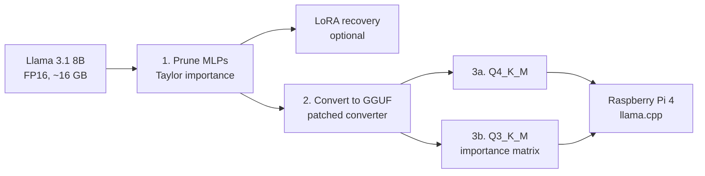

# Compressing Llama 3.1 8B for a Raspberry Pi 4

A cloud-to-edge pipeline that shrinks **Llama 3.1 8B Instruct** from about **16 GB (FP16) to 3.3–4 GB**, roughly an 80% reduction, so that it fits in the 8 GB of RAM on a Raspberry Pi 4 and runs entirely on the device.

The heavy steps (pruning, recovery fine-tuning, conversion and quantization) run on cloud GPUs through [Modal](https://modal.com); the final GGUF model runs on the Pi with [llama.cpp](https://github.com/ggerganov/llama.cpp).

> Course project for **AI on Edge Devices** at the Lahore University of Management Sciences (LUMS), built by a team of four.

## Results

| Stage | Parameters | Size | Notes |
| :--- | ---: | ---: | :--- |
| Original Llama 3.1 8B Instruct (FP16) | 8.03 B | ~16 GB | Does not fit in the Pi's 8 GB of RAM |
| After MLP pruning | 6.97 B | | WikiText-2 perplexity 11.38 |
| After LoRA recovery | 6.97 B | | WikiText-2 perplexity **9.78** |
| After quantization (Q4_K_M / Q3_K_M) | 6.97 B | **3.3–4 GB** | Fits on the Pi 4 |

- Importance-matrix (activation-aware) quantization cut **time-to-first-token by about 20%** compared with standard quantization.
- FP16 baseline on an 8-core cloud CPU: 17.5 tokens/s prompt processing and 4.0 tokens/s generation (see [`baseline/fp16_baseline.ipynb`](baseline/fp16_baseline.ipynb)).

## How it works



1. **Structured pruning.** [LLM-Pruner](https://github.com/horseee/LLM-Pruner) removes 25% of the MLP channels in layers 4–28, ranked by first-order Taylor importance. The first four layers, the last layers and all attention heads are left untouched.
2. **Recovery fine-tuning (optional).** LoRA (rank 8, 2 epochs) on an A100 recovers much of the quality lost to pruning.
3. **GGUF conversion.** Pruning leaves each layer with a different MLP width, which the official `convert_hf_to_gguf.py` cannot handle. The patched copy in this repository supports non-uniform layer sizes.
4. **Quantization.** llama.cpp quantizes the model to 4-bit (Q4_K_M) or, using an importance matrix computed on WikiText-2, to 3-bit (Q3_K_M) while protecting the most important weights.

## Repository layout

```
pipeline/
  prune.py                 Step 1: MLP-only structured pruning (A100)
  convert_to_gguf.py       Step 2: clean the pruned checkpoint and export FP16 GGUF
  convert_hf_to_gguf.py    Patched llama.cpp converter for non-uniform MLP sizes
  quantize_q4.py           Step 3, option A: standard Q4_K_M quantization
  quantize_q3_imatrix.py   Step 3, option B: importance-matrix Q3_K_M quantization
recovery/
  post_train_lora.py       LoRA fine-tuning of the pruned model
  evaluate_perplexity.py   WikiText-2 perplexity of the recovered model
baseline/
  fp16_baseline.ipynb      Perplexity and CPU throughput of the unmodified FP16 model
outlier_suppression/
  spinquant/               SpinQuant rotation experiment (did not make the final pipeline)
```

## Running it

**Prerequisites**

```bash
pip install -r requirements.txt
modal setup
```

Create a Modal secret named `huggingface-secret` containing an `HF_TOKEN` with access to [meta-llama/Llama-3.1-8B-Instruct](https://huggingface.co/meta-llama/Llama-3.1-8B-Instruct). All scripts share the Modal volume `llama31-mlp-only`.

**Pipeline** (run from the repository root)

```bash
modal run pipeline/prune.py             # 1. prune
modal run pipeline/convert_to_gguf.py   # 2. convert to FP16 GGUF
modal run pipeline/quantize_q4.py       # 3a. Q4_K_M, fastest
modal run pipeline/quantize_q3_imatrix.py  # 3b. Q3_K_M, smallest
```

**Optional recovery and evaluation**

```bash
modal run recovery/post_train_lora.py
modal run recovery/evaluate_perplexity.py --checkpoint checkpoint-1556
```

Download the quantized model from the volume and run it on the Pi with llama.cpp:

```bash
modal volume get llama31-mlp-only pruned_model_q4_k_m.gguf .
./llama-cli -m pruned_model_q4_k_m.gguf -p "Hello"
```

## What did not work

- **Uniform pruning across all layers**, instead of pruning only the middle MLP layers.
- **Zero-padding pruned layers** back to a uniform width, as an alternative to patching the GGUF converter.
- **SpinQuant** (learned rotations to suppress activation outliers before quantization) is kept in [`outlier_suppression/spinquant`](outlier_suppression/spinquant) for reference. These are modified files from Meta's [SpinQuant](https://github.com/facebookresearch/SpinQuant) and must be placed inside that repository to run.

## Acknowledgements

Built on [LLM-Pruner](https://github.com/horseee/LLM-Pruner), [llama.cpp](https://github.com/ggerganov/llama.cpp), [SpinQuant](https://github.com/facebookresearch/SpinQuant) and [Modal](https://modal.com). Third-party files keep their original licenses and copyright headers.
